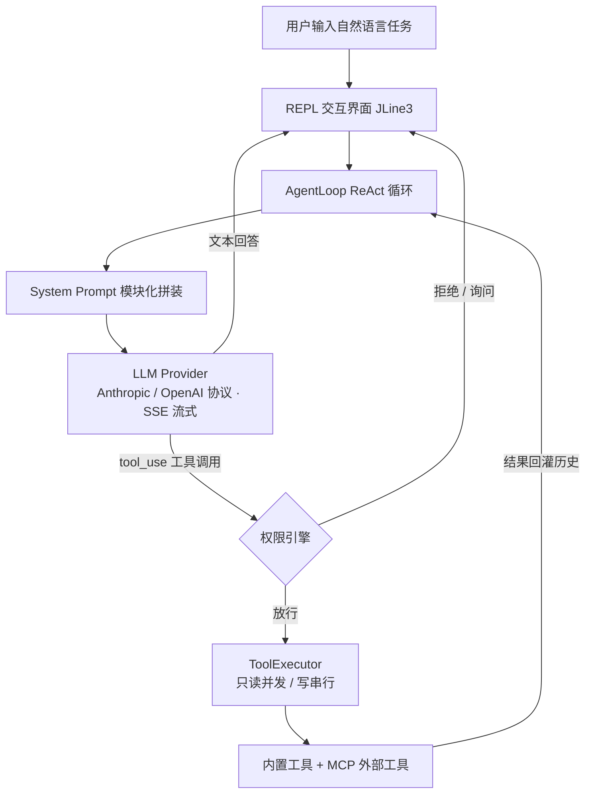

<div align="center">

# Rook

### 一个用 Java 从零实现的终端 AI 编程助手

在命令行里与大模型对话，让它读代码、改文件、跑命令、联网搜索，并通过工具调用自主完成多步编程任务。


[特性](#核心特性) · [快速开始](#快速开始) · [配置](#配置) · [内置命令](#内置命令) · [项目结构](#项目结构) · [学习笔记](#学习笔记)

</div>

---

## 这是什么

Rook 是一个运行在终端（REPL）里的 AI 编程助手，形态上对标 Claude Code，但**不依赖任何大模型 SDK**：用 JDK 内置 `HttpClient` 手写 HTTP 请求与 SSE 流式解析，自己实现 ReAct 循环、工具系统、权限引擎与上下文管理。

你用自然语言下达任务，Rook 在「思考 → 调用工具 → 观察结果 → 继续思考」的循环里自主推进，直到给出最终回答；每一步工具调用都经过权限校验，只读操作并发执行、写操作串行执行。



---

## 核心特性

| 能力 | 说明 |
| :--- | :--- |
| **ReAct Agent 循环** | 后台线程驱动「推理 ↔ 工具调用」多轮循环，事件经 `BlockingQueue` 与界面解耦，可中途取消 |
| **SSE 流式输出** | 逐 token 实时打印，同时识别 `tool_use` 事件并累积工具调用与 token 用量 |
| **双 LLM 协议** | 同时支持 Anthropic Messages API 与 OpenAI Chat Completions，按配置切换 Provider |
| **工具系统** | 内置 7 个工具：读文件、写文件、精确编辑、执行命令、glob 找文件、grep 搜代码、联网搜索 |
| **五层权限引擎** | 黑名单 → 路径沙箱（防 symlink 逃逸）→ YAML 规则 → 模式兜底 → 人在回路确认，逐层短路 |
| **MCP 扩展** | 内置 JSON-RPC 2.0 客户端，支持 stdio 子进程与 HTTP/SSE 两种传输，接入外部工具 Server |
| **上下文管理** | Token 预算估算、历史压缩摘要、工具结果存储，长对话不撑爆窗口 |
| **记忆与项目指令** | 三层项目指令加载、自动记忆（JSONL 追加）、会话存档与恢复 |
| **Skill 系统** | 可加载模块化技能包，内置 commit / review / test 三个技能 |
| **子 Agent** | 内置 explore（只读探索）、general-purpose（通用）、plan（规划设计）三类子代理 |
| **团队协作** | Mailbox 信箱 + TaskBoard 任务板，多成员分工协调 |
| **Worktree 隔离** | 任务在独立工作树中改动，互不污染 |
| **Hook 引擎** | 生命周期事件（使用前 / 会话开始等）挂载自定义规则动作 |

---

## 技术栈

| 层次 | 选型 |
| :--- | :--- |
| 语言 / 运行时 | Java 17（record、Optional、流式 API） |
| 构建 | Maven + Maven Wrapper（无需预装 Maven） |
| JSON / 配置 | Jackson、SnakeYAML |
| 终端交互 | JLine 3（行编辑、历史、Tab 补全、跨平台中文输出） |
| HTTP / 流式 | JDK 内置 `java.net.http.HttpClient`，手写 SSE 解析 |
| 外部工具 | MCP（Model Context Protocol）JSON-RPC 2.0 |
| 测试 | JUnit 5 + Mockito |

---

## 快速开始

### 1. 环境要求

- JDK 17（[Adoptium Temurin 17](https://adoptium.net/)）
- 一个兼容 Anthropic 或 OpenAI 协议的大模型 API Key

### 2. 配置 API Key

Key 通过**环境变量**注入，不写进配置文件。`config.yaml` 中用 `${ENV_VAR}` 占位引用：

```yaml
default_provider: deepseek
providers:
  - name: deepseek
    protocol: anthropic
    model: deepseek-v4-pro
    base_url: https://api.deepseek.com/anthropic
    api_key: ${DEEPSEEK_API_KEY}
```

设置环境变量：

```powershell
# PowerShell（当前会话）
$env:DEEPSEEK_API_KEY = "sk-你的key"
```

```cmd
:: Windows CMD
set DEEPSEEK_API_KEY=sk-你的key
```

```bash
# macOS / Linux
export DEEPSEEK_API_KEY=sk-你的key
```

### 3. 编译打包

Windows：

```cmd
mvnw.cmd package -DskipTests
```

macOS / Linux：

```bash
./mvnw package -DskipTests
```

产物为自包含 fat jar：`target/rook-0.1.0-SNAPSHOT.jar`。

### 4. 启动

```bash
java -jar target/rook-0.1.0-SNAPSHOT.jar
```

指定自定义配置文件：

```bash
java -jar target/rook-0.1.0-SNAPSHOT.jar --config /path/to/config.yaml
```

进入 REPL 后直接输入任务即可，例如「读一下 pom.xml 并说明依赖」。

---

## 配置

### 多 Provider 与协议

`protocol` 决定走哪套请求格式：

- `anthropic`：请求 `{base_url}/messages`，使用 `x-api-key` 与 `content blocks` 结构
- `openai`：请求 `{base_url}/chat/completions`，使用 `Bearer` 与 `tool_calls` 结构

可在 `providers` 下配置多个，运行时切换默认 Provider。

### 联网搜索（可选）

不配搜索 Key 时回退到网页 HTML 抓取；配置后走 API：

```yaml
search:
  glm_api_key: ${GLM_SEARCH_API_KEY:-}
  brave_api_key: ${BRAVE_SEARCH_API_KEY:-}
```

### MCP Server

在 `.rook/mcp.yaml` 中声明外部工具 Server，支持 stdio 与 HTTP：

```yaml
servers:
  everything:
    type: stdio
    command: npx
    args: ["-y", "@modelcontextprotocol/server-everything"]
```

---

## 内置命令

在 REPL 中以 `/` 开头触发本地命令：

| 命令 | 作用 |
| :--- | :--- |
| `/help` | 显示全部可用命令 |
| `/exit` | 退出 Rook |
| `/plan` | 进入计划模式（只读工具，只出方案不动手） |
| `/do` | 退出计划模式并执行方案 |
| `/compact` | 手动触发上下文压缩 |
| `/clear` | 清空对话历史，开启新会话 |
| `/session` | 显示当前会话信息 |
| `/memory` | 列出已加载的记忆文件 |
| `/permission` | 查看当前权限模式 |
| `/status` | 显示系统状态 |
| `/worktree` | 管理任务工作树 |
| `/team` | 团队管理（list / create / delete） |

---

## 项目结构

```
rook/
├── pom.xml                      # Maven 配置（shade 打 fat jar）
├── config.yaml                  # LLM Provider 配置（环境变量占位）
├── src/main/java/com/rook/
│   ├── cli/                     # 入口与 REPL 交互
│   ├── cmd/                     # 斜杠命令注册与分发
│   ├── core/agent/              # AgentLoop 循环引擎与事件体系
│   ├── llm/                     # Provider、SSE 流式收集、消息模型
│   ├── tools/                   # 工具注册中心 / 执行器 + 7 个内置工具
│   ├── permission/              # 五层权限引擎
│   ├── mcp/                     # JSON-RPC 客户端（stdio / HTTP）
│   ├── prompt/                  # 模块化 System Prompt 拼装
│   ├── context/                 # 上下文预算、压缩摘要、结果存储
│   ├── memory/                  # 自动记忆、项目指令、会话存档
│   ├── skills/                  # Skill 加载与内置技能
│   ├── subagent/                # 子 Agent 定义与调度
│   ├── team/                    # Mailbox / TaskBoard 团队协作
│   ├── hook/                    # 生命周期 Hook 引擎
│   ├── worktree/                # 任务工作树隔离
│   ├── session/                 # 会话历史持久化
│   ├── config/                  # YAML 配置加载与校验
│   └── util/                    # 通用工具
└── docs/笔记/                   # 逐章实现笔记（见下）
```

---

## 学习笔记

`docs/笔记/` 下保存了从零构建 Rook 的逐章拆解，涵盖架构总览、LLM 接口调用、SSE 流式解析、ReAct 循环、权限引擎、MCP 客户端、上下文管理、Skill / Hook / 子 Agent / 团队协作、打包分发等主题，适合对照源码阅读。

---

## 说明

本项目用于个人学习与技术研究，完整手写 Agent 工程的各环节实现；暂未附加开源许可证，请勿直接用于商业交付。

<div align="center">

<sub>Rook — 终端里的自主编程助手</sub>

</div>
